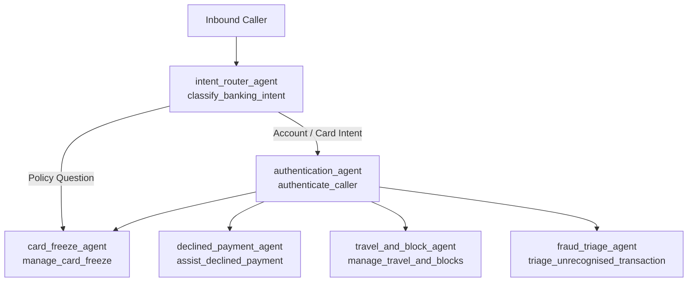
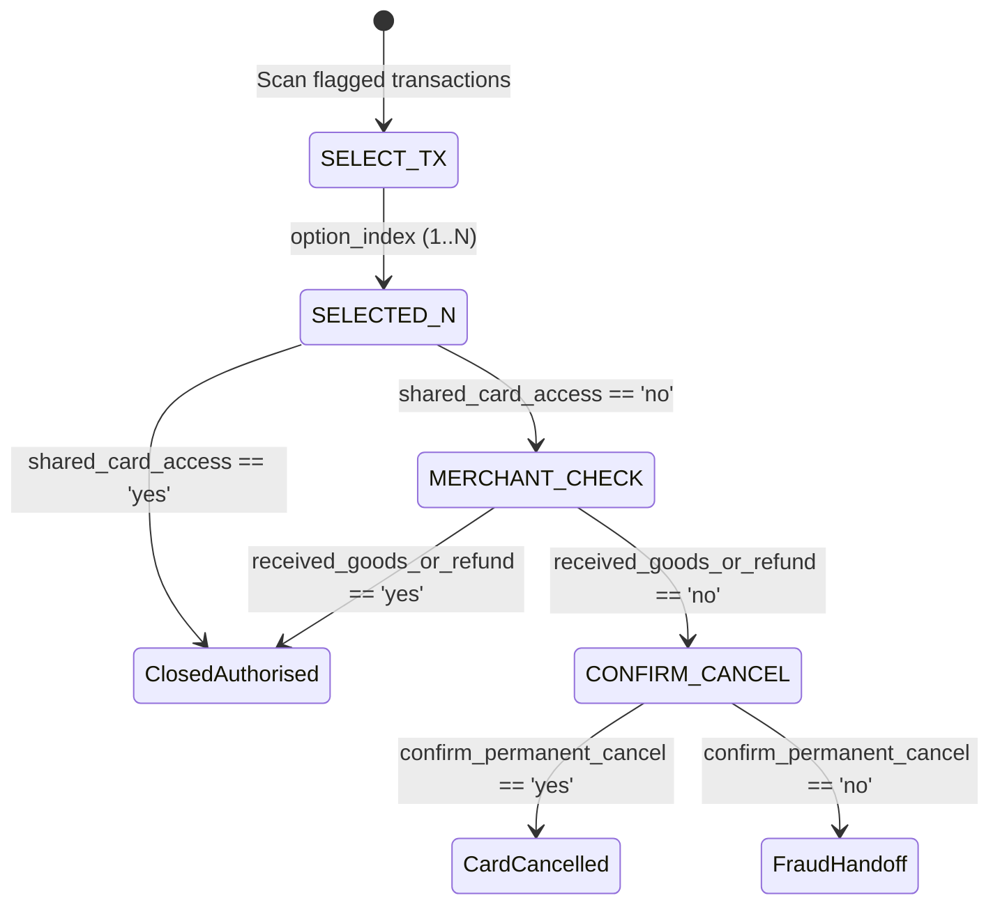

# Albion Bank Card Protection & Fraud Triage: Participant Lab Workbook

This workbook guides you through the two-day hands-on engineering lab for CX Agent Studio (GECX). You will work on the `kata-starter` branch of the Albion Bank Card Protection voice application, where several common anti-patterns and incomplete tool scaffolds have been planted.

| Session | Focus | Goal |
|---|---|---|
| **Day 1 Morning** | Katas 1, 2 & 3 | Fix 6 seeded anti-patterns across prompts, controllers, and callbacks |
| **Day 1 Afternoon** | Declined Payments | Complete 3 TODOs in `assist_declined_payment` |
| **Day 2 Morning** | Fraud Triage | Implement the 4-step dispatcher in `triage_unrecognised_transaction` |
| **Day 2 Afternoon** | Sandbox & Evals | Push your bundle, run tool tests, and execute golden evaluations |

---

## 1. Environment Setup & Pre-Flight Check

### 1.1 Authenticate Google Cloud

Sign in with the Google Cloud CLI and set `CXAS_APP_NAME` to your assigned sandbox application resource ID:

```bash
gcloud auth login
gcloud auth application-default login
gcloud auth application-default set-quota-project "<YOUR_SANDBOX_PROJECT>"

export CXAS_APP_NAME="projects/<YOUR_SANDBOX_PROJECT>/locations/<REGION>/apps/<YOUR_APP_UUID>"
```

### 1.2 Clone the Repository and Verify the Starter Branch

Clone the repository, switch to the `kata-starter` branch, and install dependencies with `uv`:

```bash
git clone https://github.com/cloud-gtm/lbg-albion-bank-gecx-lab.git
cd lbg-albion-bank-gecx-lab
git checkout kata-starter
uv sync --locked
```

Verify that the starter branch and local test runner work:

```bash
uv run python scripts/prepare_kata_starter.py --verify-starter .
uv run pytest tests/test_middleware_service.py -v
```

Run the static linter to see the seeded issues you will fix in Kata 1–3:

```bash
uv run cxas lint
```

### 1.3 Application Architecture

The application uses six agents coordinated by Python controller tools and model callbacks:

*(Diagram: "Inbound Caller" → `intent_router_agent` / `classify_banking_intent` → (edge "Account / Card Intent") `authentication_agent` / `authenticate_caller`; `intent_router_agent` → (edge "Policy Question") `card_freeze_agent` / `manage_card_freeze`; `authentication_agent` → `card_freeze_agent` / `manage_card_freeze`, `declined_payment_agent` / `assist_declined_payment`, `travel_and_block_agent` / `manage_travel_and_blocks`, `fraud_triage_agent` / `triage_unrecognised_transaction`.)*



| Agent | Controller Tool | Role |
|---|---|---|
| `intent_router_agent` | `classify_banking_intent` | Classifies the caller's request and confirms the intent before routing |
| `authentication_agent` | `authenticate_caller` | Matches CLI or 4-digit card ending and verifies the 6-digit passcode |
| `card_freeze_agent` | `manage_card_freeze` | Freezes, unfreezes, or replaces a card and answers policy questions |
| `declined_payment_agent` | `assist_declined_payment` | Diagnoses and resolves declined card and digital wallet payments |
| `travel_and_block_agent` | `manage_travel_and_blocks` | Unblocks overseas declines and registers travel notices (completed reference) |
| `fraud_triage_agent` | `triage_unrecognised_transaction` | Runs the 3-step fraud triage checklist and reissues compromised cards |

Every Python controller tool follows three rules:

1. Read and write session state through `context.state`.
2. Return a single-key dictionary (`{"agent_action": "..."}`) telling the model what to say next.
3. Queue sub-agent handoffs by setting `context.state["target_agent"]` rather than routing in prompt text.

---

## 2. Kata 1: Structured Prompts & Authentication Controller

| ID | File | What Is Broken |
|---|---|---|
| 1 | `agents/intent_router_agent/instruction.txt` | Uses `IF` / `ELSE IF` rules, `<state_update>` tags, and `{@AGENT: ...}` transfers in the prompt instead of calling `classify_banking_intent`. Missing `<persona>` and `<examples>`. |
| 3A | `agents/authentication_agent/instruction.txt` | Hardcodes a transfer to `card_freeze_agent` in the prompt instead of letting `authenticate_caller` route the caller. Missing `<examples>` and the `end_session` constraint. |
| 2A | `tools/authenticate_caller/.../python_code.py` | Checks `"yes"` / `"no"` confirmation before checking new card digits, ignoring corrections like *"No, wait, my card ends in 4821"*. |
| 2B | `tools/authenticate_caller/.../python_code.py` | Returns the raw backend dictionary on CLI match, leaking internal CRM notes instead of returning `{"agent_action": ...}`. |
| 2C | `tools/authenticate_caller/.../python_code.py` | Never counts failed passcode attempts, allowing unlimited retries instead of escalating after 2 failures. |

### Step 1A: Refactor `intent_router_agent/instruction.txt`

**File:** `cxas_app/Albion_Bank_Card_Protection/agents/intent_router_agent/instruction.txt`

Rewrite the router prompt so all classification and routing happen inside the `classify_banking_intent` tool:

- [ ] Structure the prompt into five XML sections: `<role>`, `<persona>`, `<constraints>`, `<taskflow>`, and `<examples>`.
- [ ] Instruct the model to call `{@TOOL: classify_banking_intent}` on every turn and speak the guidance returned in `agent_action`.
- [ ] Remove all `IF` / `ELSE IF` branching rules, `<state_update>` tags, and `{@AGENT: ...}` tokens.
- [ ] Add a constraint stating that `{@TOOL: end_session}` is only used by callbacks and must never be called directly.
- [ ] Add 1–2 short few-shot examples in `<examples>` (keep the file under 60 lines).

> 💡 **Hint & Reference**
>
> - **Why reference declared tools?** Linter rule `I012` checks that tools attached to an agent in its `.json` manifest are referenced in `instruction.txt`, and the unit tests verify that `{@TOOL: end_session}` is explicitly restricted in `<constraints>`.
> - **Example format:** CX Agent Studio requires inline examples to use `EXAMPLE 1:`, `Begin example`, `[user]`, `[model]`, and `End example`.
> - **Reference:** Open `cxas_app/Albion_Bank_Card_Protection/agents/card_freeze_agent/instruction.txt` to see the exact XML layout and example syntax.

### Step 1B: Refactor `authentication_agent/instruction.txt`

**File:** `cxas_app/Albion_Bank_Card_Protection/agents/authentication_agent/instruction.txt`

Remove the hardcoded agent transfer from the authentication prompt:

- [ ] Delete all `{@AGENT: card_freeze_agent}` references from `<constraints>` and `<taskflow>`.
- [ ] Add the `{@TOOL: end_session}` constraint in `<constraints>` so every declared tool is documented in the prompt.
- [ ] Add an `<examples>` section at the bottom showing a turn that calls `authenticate_caller`.

> 💡 **Hint & Reference**
>
> - When passcode verification succeeds, `authenticate_caller` sets `context.state["target_agent"]` automatically based on `confirmed_intent`, so the prompt should never hardcode a destination agent.
> - **Reference:** Compare with `cxas_app/Albion_Bank_Card_Protection/agents/card_freeze_agent/instruction.txt`.

### Step 1C: Fix Anti-Patterns 2A, 2B, and 2C in `authenticate_caller`

**File:** `cxas_app/Albion_Bank_Card_Protection/tools/authenticate_caller/python_function/python_code.py`

Locate the three `# KATA 1 ANTI-PATTERN` comments and fix each one using the helper functions already in the file:

- [ ] **Fix 2A (Slot Precedence in Step 4):** Check `card_last4` and `passcode` **before** checking `number_confirmed` in `("yes", "no")`.
- [ ] **Fix 2B (Return Contract in `_initiate_identification`):** When the phone number lookup matches a customer, call `_ask_to_confirm_card(...)` instead of returning the raw `payload` dictionary.
- [ ] **Fix 2C (Retry Lockout in `_verify_passcode`):** Increment `auth_attempts` in session state on each failed passcode check and escalate when it reaches `_MAX_AUTH_ATTEMPTS` (`2`).

> 💡 **Hint & Dispatch Order**
>
> Step 4 evaluation order for Fix 2A:
>
> | Order | Condition | Helper to Call |
> |---|---|---|
> | 1 | `card_last4` and `passcode` and not `state.get("card_confirmed")` | `_lookup_then_verify(card_last4, passcode)` |
> | 2 | `passcode` (if `number_confirmed == "yes"` and not `state.get("card_last4")`, first set `state["card_confirmed"] = True`) | `_verify_passcode(passcode)` |
> | 3 | `card_last4` | `_lookup_card_last4(card_last4)` |
> | 4 | `number_confirmed in ("yes", "no")` | `_handle_card_confirmation(number_confirmed)` |
> | 5 | `state.get("card_confirmed")` | `_prompt_for_passcode()` |
> | 6 | Fallback | `_initiate_identification()` |
>
> **Session state tip for Fix 2C:**
>
> - `auth_attempts` is declared as a string in `app.json`. Increment it with `attempts = int(context.state.get("auth_attempts") or "0") + 1` and save `context.state["auth_attempts"] = str(attempts)`.
> - Call `_escalate("PASSCODE_FAILED")` when `attempts >= _MAX_AUTH_ATTEMPTS`.

### ✅ Verify Kata 1

```bash
uv run pytest tests/test_router_and_auth.py -k kata1 -v
```

---

## 3. Kata 2: Callback Chains, Silent Transfers & Line Release

| ID | File | What Is Broken |
|---|---|---|
| 3B | `agents/authentication_agent/.../agent_transfer/python_code.py` | Does not clear `target_agent` after reading it, and keeps the current agent's spoken text on live calls (causing double-speaking). |
| 4A | `agents/card_freeze_agent/.../release_line/python_code.py` | Mutates `parts.append(...)` in place and returns `None`, so CXAS ignores it and the call never hangs up. |
| 4B | `agents/card_freeze_agent/card_freeze_agent.json` | Missing `silence_detection` in `beforeModelCallbacks`, and runs `release_line` before `agent_transfer` in `afterModelCallbacks`. |

### Step 2A: Fix `agent_transfer` in `authentication_agent`

**File:** `cxas_app/Albion_Bank_Card_Protection/agents/authentication_agent/after_model_callbacks/agent_transfer/python_code.py`

Update the callback so sub-agent transfers fire once and do not double-speak on live calls:

- [ ] Clear `target_agent` in session state right after reading it so the transfer cannot loop.
- [ ] Return `None` if `target_agent` equals `callback_context.agent_name`.
- [ ] On live voice calls, return only the transfer part (strip the current agent's text parts). Keep the text parts only during offline evaluation runs.

> 💡 **Hint & Reference**
>
> - Reset with `state["target_agent"] = ""` (never use `.pop()` or `None` on CXAS session state).
> - Offline evaluation sessions have a `callback_context.session_id` starting with `"evaluation"`.
> - **Reference:** Compare with `agents/travel_and_block_agent/after_model_callbacks/agent_transfer/python_code.py`.

### Step 2B: Fix `release_line` in `card_freeze_agent`

**File:** `cxas_app/Albion_Bank_Card_Protection/agents/card_freeze_agent/after_model_callbacks/release_line/python_code.py`

Fix the callback so CXAS actually terminates the session when `call_complete` is `"true"`:

- [ ] Latch `state["call_complete"] = "released"` so the hang-up only triggers once.
- [ ] Determine the end-session reason (`state.get("escalation_reason") or "CALL_COMPLETED"`) and whether the call was escalated (`reason != "CALL_COMPLETED"`).
- [ ] Return a new `LlmResponse.from_parts(...)` containing the spoken text parts plus `Part.from_end_session(...)`.

> 💡 **Hint & Reference**
>
> - In CXAS, mutating `llm_response.content.parts` in place and returning `None` discards your changes. You must return a new `LlmResponse`.
> - **Reference:** Compare with `agents/travel_and_block_agent/after_model_callbacks/release_line/python_code.py`.

### Step 2C: Fix Callback Ordering in `card_freeze_agent.json`

**File:** `cxas_app/Albion_Bank_Card_Protection/agents/card_freeze_agent/card_freeze_agent.json`

Update the callback arrays in the agent manifest:

- [ ] In `beforeModelCallbacks`, keep `capture_utterance` first and add `silence_detection` second.
- [ ] In `afterModelCallbacks`, place `agent_transfer` **before** `release_line`.

> 💡 **Hint & Reference**
>
> - **Reference:** Check `agents/travel_and_block_agent/travel_and_block_agent.json` for the exact callback paths and JSON structure.

### ✅ Verify Kata 2

```bash
uv run pytest tests/test_callback_chains.py -k kata2 -v
```

---

## 4. Kata 3: Tool Encapsulation, Verbatim Disclosures & Loop Guard

| ID | File | What Is Broken |
|---|---|---|
| 5 | `agents/card_freeze_agent/card_freeze_agent.json` | Exposes raw OpenAPI toolsets (`albion_core_api`, `vault_kb_api`) in `"tools"`, letting the model bypass `manage_card_freeze`. |
| 5A | `tools/manage_card_freeze/.../python_code.py` | Writes to an undeclared state key (`"language"`) and checks `"yes"` / `"no"` confirmation before `"freeze"` / `"unfreeze"` actions. |
| 5B | `tools/manage_card_freeze/.../python_code.py` | Includes internal article IDs (`[ALB-KB-4412-INTERNAL]`) in `agent_action`, so the agent reads them aloud. |
| 6A | `tools/manage_card_freeze/.../python_code.py` | Does not stage the freeze disclosure in `verbatim_script` or lock barge-in when freezing a card. |
| 6B | `agents/card_freeze_agent/.../capture_utterance/python_code.py` | Missing Stage 6 (verbatim disclosure delivery) and Stage 7 (8-pass reasoning loop cap). |

### Step 3A: Encapsulate Tools in `card_freeze_agent.json`

**File:** `cxas_app/Albion_Bank_Card_Protection/agents/card_freeze_agent/card_freeze_agent.json`

- [ ] Remove `"albion_core_api"` and `"vault_kb_api"` from `"tools"` so only `"manage_card_freeze"` and `"end_session"` remain.

### Step 3B: Fix Anti-Patterns 5A, 5B, and 6A in `manage_card_freeze`

**File:** `cxas_app/Albion_Bank_Card_Protection/tools/manage_card_freeze/python_function/python_code.py`

Locate the three `# KATA 3 ANTI-PATTERN` comments:

- [ ] **Fix 5A:** Delete the undeclared `context.state["language"] = "en-GB"` line at the top of `manage_card_freeze`, and delete the premature `if confirmed in ("yes", "no"):` block above `if action in ("freeze", "unfreeze"):` in Step 5.
- [ ] **Fix 5B:** In `_answer_policy_question()`, remove `[{article_id}]` from the strings passed to `_reply(...)` so only the spoken summary (and any paused-workflow follow-up question) is returned.
- [ ] **Fix 6A:** In `_set_temporary_freeze()`, when `freeze_flag` is `True`, stage the disclosure in session state (`verbatim_script` and `verbatim_lock_barge_in`) before returning `_reply(disclosure)`.

> 💡 **Hint & Reference**
>
> - **Why remove the early `confirmed` check in Step 5?** If a caller is asked to confirm permanent card replacement and replies *"No, just freeze it temporarily"*, the model extracts both `confirmed="no"` and `action="freeze"`. Checking `action` first ensures the card is frozen.
> - **How to stage verbatim disclosures (Fix 6A):** Look at `_execute_card_cancellation()` in `tools/triage_unrecognised_transaction/python_function/python_code.py` to see how it sets `context.state["verbatim_script"] = disclosure` and `context.state["verbatim_lock_barge_in"] = True`.

### Step 3C: Add Verbatim Lock and Loop Cap in `capture_utterance`

**File:** `cxas_app/Albion_Bank_Card_Protection/agents/card_freeze_agent/before_model_callbacks/capture_utterance/python_code.py`

Replace the `# KATA 3 ANTI-PATTERN 6B` comment at the end of `before_model_callback` with Stages 6 and 7:

- [ ] **Stage 6 (Verbatim Disclosure Delivery):** When `verbatim_script` is set on a tool response turn, clear the staged state flags and return an `LlmResponse` that delivers the disclosure word-for-word with barge-in disabled.
- [ ] **Stage 7 (8-Pass Loop Cap):** Define `_MAX_PASSES = 8` and escalate with `MAX_PASSES_EXCEEDED` if `count > _MAX_PASSES`.

> 💡 **Hint & Reference**
>
> - Every agent in the bundle shares the same `capture_utterance` callback.
> - **Reference:** Open `agents/travel_and_block_agent/before_model_callbacks/capture_utterance/python_code.py` to see how Stage 6, Stage 7, and the `_deliver_verbatim_script` helper are implemented.

### ✅ Verify Kata 3 (All Morning Katas Complete)

```bash
uv run cxas lint
uv run pytest tests/test_router_and_auth.py tests/test_callback_chains.py -k "kata1 or kata2 or kata3" -v
uv run pytest tests/test_bundle_integrity.py -v
```

`cxas lint` should now report **0 errors and 0 warnings**, and all tests should pass.

---

## 5. Day 1 Afternoon: Declined Payment Controller (`assist_declined_payment`)

### How the Controller Works

Instead of making the LLM query four separate backend systems, `assist_declined_payment` calls the `payment_support_api` middleware. The middleware runs a diagnostic waterfall and returns:

| Response Field | Purpose |
|---|---|
| `customer_guidance.message` | Spoken explanation or question for the caller |
| `diagnosis.summary` | Background context so the model can answer follow-up questions without another tool call |
| `next_action` | HATEOAS state object (`action_type`, `when_confirmed`, `when_declined`) |

All helper functions in `cxas_app/Albion_Bank_Card_Protection/tools/assist_declined_payment/python_function/python_code.py` are already implemented. You only need to complete **TODO 1**, **TODO 2**, and **TODO 3**.

### Step 3.1: Complete TODO 2 and TODO 1 in `_answer_pending_action`

**File:** `cxas_app/Albion_Bank_Card_Protection/tools/assist_declined_payment/python_function/python_code.py`

Locate `_answer_pending_action(pending, confirmed, merchant_name)` and replace the two `NOT_IMPLEMENTED` blocks:

- [ ] **TODO 2 (`SELECT_TRANSACTION`):** When multiple declined payments exist on the card, check if the caller provided a `merchant_name`. If empty, call `_handle_unmatched_selection()`; otherwise diagnose the selected merchant.
- [ ] **TODO 1 (`when_confirmed` / `when_declined`):** When `confirmed` is `"yes"` or `"no"`, look up the corresponding HATEOAS branch (`when_confirmed` or `when_declined`) from `pending` and pass it to `_follow_branch(branch, merchant_name)` when non-empty (falling through to the pre-populated ambiguous-reply handler if empty).

> 💡 **Hint & Helper Functions**
>
> - **For TODO 2:** Call `_run_diagnosis("", merchant_name, is_selection_turn=True)` when `merchant_name.strip()` is non-empty, and `_handle_unmatched_selection()` when blank.
> - **For TODO 1 (yes / no branch):** Select `branch = pending.get("when_confirmed" if confirmed == "yes" else "when_declined") or {}`. When `branch` is non-empty, return `_follow_branch(branch, merchant_name)`. (The merchant-switch check above `if confirmed in ("yes", "no"):` and the ambiguous-reply fallback below it are already implemented.)

### Step 3.2: Complete TODO 3 in `_reply`

**File:** `cxas_app/Albion_Bank_Card_Protection/tools/assist_declined_payment/python_function/python_code.py`

Locate `_reply(action, diagnosis_summary="")` at the bottom of the file:

- [ ] Store the plain `action` string in `context.state["last_agent_action"]` (without appending `diagnosis_summary`).
- [ ] When `diagnosis_summary` is non-empty (and not already in `action`), append `[Diagnosis context: <diagnosis_summary>]` to the `"agent_action"` string returned to the model.

> 💡 **Hint**
>
> - **Why keep `last_agent_action` clean?** If the caller stays silent, `silence_detection` reads `last_agent_action` to repeat the question aloud - it should never read internal `[Diagnosis context: ...]` notes to the caller.

### ✅ Verify Day 1 Afternoon

```bash
uv run cxas lint
uv run pytest tests/test_middleware_service.py tests/test_callback_chains.py -v
uv run pytest tests/test_controller_state_matrix.py -k "assist_declined_payment" -v
```

---

## 6. Day 2 Morning: Fraud Triage Controller (`triage_unrecognised_transaction`)

### How the Controller Works

When a caller reports an unrecognised payment, `triage_unrecognised_transaction` walks through a 4-stage checklist tracked in `context.state["fraud_triage_step"]`:

*(Diagram: state machine. Start → (edge "Scan flagged transactions") `SELECT_TX` → (edge "option_index (1..N)") `SELECTED_N`. `SELECTED_N` → (edge "shared_card_access == 'yes'") `ClosedAuthorised`; `SELECTED_N` → (edge "shared_card_access == 'no'") `MERCHANT_CHECK`. `MERCHANT_CHECK` → (edge "received_goods_or_refund == 'yes'") `ClosedAuthorised`; `MERCHANT_CHECK` → (edge "received_goods_or_refund == 'no'") `CONFIRM_CANCEL`. `CONFIRM_CANCEL` → (edge "confirm_permanent_cancel == 'yes'") `CardCancelled`; `CONFIRM_CANCEL` → (edge "confirm_permanent_cancel == 'no'") `FraudHandoff`.)*



> Note: the diagram in the screenshot is small and low-resolution; edge labels and the exact terminal-state names (`ClosedAuthorised`, `CardCancelled`, `FraudHandoff`) were read at reduced legibility, and the `CONFIRM_CANCEL` → terminal edge labels are inferred from the layout.

### Step 4.1: Implement the 4-Step Dispatcher

**File:** `cxas_app/Albion_Bank_Card_Protection/tools/triage_unrecognised_transaction/python_function/python_code.py`

All step helpers (`_is_intent_switch`, `_handle_intent_switch`, `_select_transaction`, `_execute_card_cancellation`, `_handle_merchant_check`, `_handle_shared_access_check`, `_reprompt_triage_step`, `_scan_and_present_menu`, `_menu_text`, `_reply`, and `_escalate`) are already implemented below the entrypoint.

Replace the `NOT_IMPLEMENTED` stub inside `triage_unrecognised_transaction(...)`:

- [ ] **Step 1 (Intent Switch):** If `_is_intent_switch(switch_intent)` is true, delegate to `_handle_intent_switch(switch_intent)`.
- [ ] **Step 2 (Auth Gate):** If `not state.get("auth_verified")`, set `confirmed_intent = "UNRECOGNISED_TRANSACTION"`, queue `target_agent = "authentication_agent"`, and return a `_reply(...)` explaining that security verification is needed first.
- [ ] **Step 3 (Step-Gated Answer Dispatch):** Dispatch the caller's answer based on the current `fraud_triage_step` so an out-of-order `"yes"` or `"no"` cannot skip ahead to card cancellation.
- [ ] **Step 4 (Initial Scan or Menu Re-Prompt):** If `pending_tx_options` is empty, call `_scan_and_present_menu()`; otherwise re-prompt the caller to choose a valid option number (`1` to `len(options)`).
- [ ] **Error Boundary:** Wrap the function in `try / except Exception:` and return `_escalate("FRAUD_TRIAGE_ERROR")` on unexpected errors.

> 💡 **Hint & Step 3 Dispatch Table**
>
> - **Reference:** Compare with `tools/manage_travel_and_blocks/python_function/python_code.py` to see the standard 4-step controller layout.
> - **For Step 2 (Auth Gate):** Return `_reply("Let the customer know you need to verify their security details before reviewing recent transactions on their card.")`.
> - Let `step = str(state.get("fraud_triage_step") or "")` and `options = state.get("pending_tx_options") or []`. Evaluate Step 3 in this order:
>
> | Order | Condition | Helper to Call |
> |---|---|---|
> | 1 | `1 <= option_index <= len(options)` | `_select_transaction(options, option_index)` |
> | 2 | `step == "CONFIRM_CANCEL"` and `confirm_permanent_cancel in ("yes", "no")` | `_execute_card_cancellation(confirm_permanent_cancel)` |
> | 3 | `step == "MERCHANT_CHECK"` and `received_goods_or_refund in ("yes", "no")` | `_handle_merchant_check(received_goods_or_refund)` |
> | 4 | `step.startswith("SELECTED_")` and `shared_card_access in ("yes", "no")` | `_handle_shared_access_check(shared_card_access)` |
> | 5 | `step.startswith("SELECTED_")` or `step in ("MERCHANT_CHECK", "CONFIRM_CANCEL")` | `_reprompt_triage_step(step)` |
>
> - For Step 4 when `options` is already non-empty, return: `_reply(f"Ask the customer in a single spoken sentence to choose a valid option number (1 to {len(options)}): {_menu_text(options)}")`

### ✅ Verify Day 2 Morning (Full Local Bundle Check)

```bash
uv run cxas lint
uv run pytest tests/test_router_and_auth.py tests/test_callback_chains.py
tests/test_controller_state_matrix.py tests/test_bundle_integrity.py -v
```

---

## 7. Day 2 Afternoon: Sandbox Deployment & Evaluations

### 7.1 Push Your Bundle to the CXAS Sandbox

```bash
uv run cxas push \
  --app-dir cxas_app/Albion_Bank_Card_Protection \
  --app-name "$CXAS_APP_NAME" \
  --overwrite
```

### 7.2 Run Deterministic Tool Tests (`cxas test-tools`)

```bash
uv run cxas test-tools \
  --app-name "$CXAS_APP_NAME" \
  --test-file evals/tool_tests/controller_tool_tests.yaml
```

### 7.3 Push and Run Golden Multi-Turn Evaluations

```bash
for file in evals/goldens/*.yaml; do
  uv run cxas push-eval --app-name "$CXAS_APP_NAME" --file "$file"
done

uv run cxas run \
  --app-name "$CXAS_APP_NAME" \
  --tags card_freeze declined_payment fraud_triage overseas_travel \
  --golden-run-method NAIVE \
  --wait
```

To run a single journey tag while iterating:

```bash
uv run cxas run \
  --app-name "$CXAS_APP_NAME" \
  --tags card_freeze \
  --golden-run-method NAIVE \
  --wait
```

### 7.4 Run Scenario Simulations

```bash
mkdir -p /tmp/eval-report
uv run cxas evals report \
  --run \
  --app-name "$CXAS_APP_NAME" \
  --include sims \
  --simulation-dir evals/simulations \
  --use-tool-fakes \
  --output-dir /tmp/eval-report
```
